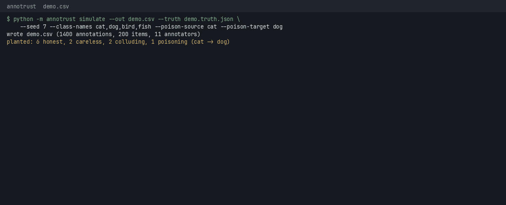

# Annotrust

Detect suspicious annotators and poisoned labels in your training data.

[](https://github.com/koushikchowdary6/annotrust/actions/workflows/ci.yml)
[](LICENSE)
[](https://www.python.org/downloads/)

## The problem

Outsourced annotation is a supply chain for training data. The file that comes back is a table of `item_id`, `annotator_id`, and `label`. Some workers click without reading. Some copy each other. Some flip one class into another so a later model learns the wrong boundary. That last pattern is targeted label poisoning: the annotator is accurate everywhere except the class they were told to move.

Annotrust reads that table offline and writes a report. It does not train a model and it does not call a vendor API.

## Flagship demo

Python 3.11 or newer. From a checkout:

```bash
python -m pip install -e .
python -m annotrust simulate \
  --out demo.csv \
  --truth demo.truth.json \
  --seed 7 \
  --class-names cat,dog,bird,fish \
  --poison-source cat \
  --poison-target dog
python -m annotrust scan demo.csv \
  --json demo.json \
  --html demo.html \
  --fail-on high
echo "exit: $?"
```

`simulate` prints, on stdout:

```text
wrote demo.csv (1400 annotations, 200 items, 11 annotators)
planted: 6 honest, 2 careless, 2 colluding, 1 poisoning (cat -> dog)
wrote demo.truth.json
```

`scan` prints this report on stdout. Stderr is `wrote demo.json` and `wrote demo.html`. The process exits 1 because `--fail-on high` and five annotators are high.

```text
Annotrust 0.1.0
source: demo.csv
annotations: 1400   items: 200   annotators: 11   classes: bird, cat, dog, fish
consensus: Dawid-Skene EM, 23 iterations, log-likelihood -1120.3
annotator severity: 5 high, 0 medium, 0 low

id               primary       severity     n accuracy  notes
careless_00      careless      high       108    0.269  low agreement 0.27; fast labels 100% of gaps under 2s, median 0.45s
careless_01      careless      high        94    0.234  low agreement 0.23, constant-label streak 94; fast labels 100% of gaps under 2s, median 0.50s
colluder_00      colluding     high       200    0.650  pair colluder_01 kappa=0.97 excess=0.43 joint_wrong=67 score=0.60
colluder_01      colluding     high       200    0.660  pair colluder_00 kappa=0.97 excess=0.43 joint_wrong=67 score=0.60
poisoner_00      poisoning     high       200    0.715  flip cat->dog rate=0.96 conc=1.00 n=48
honest_00        honest        -           98    0.888
honest_01        honest        -          103    0.903
honest_02        honest        -          105    0.905
honest_03        honest        -           92    0.870
honest_04        honest        -          103    0.874
honest_05        honest        -           97    0.938

pairs scored: 55    flagged pairs: 1
a                b                    n   kappa  excess  wrong   score  severity
colluder_00      colluder_01        200    0.97    0.43     67    0.60  high

item flags: 10 of 200
Flagged items are unstable or the majority label conflicts with the Dawid-Skene consensus.
That is a suspicion, not proof the item is mislabeled.
item           estimate       conf majority      share entropy  reasons
item_0137      fish           0.95 bird           0.57    0.15  majority_overturned
item_0113      fish           0.97 bird           0.43    0.09  majority_overturned
item_0182      fish           0.99 cat            0.57    0.04  majority_overturned
item_0086      fish           0.99 cat            0.43    0.03  majority_overturned
item_0010      dog            1.00 cat            0.43    0.01  majority_overturned
item_0094      cat            1.00 dog            0.57    0.01  majority_overturned
item_0067      cat            1.00 dog            0.57    0.01  majority_overturned
item_0062      dog            1.00 bird           0.43    0.00  majority_overturned
item_0179      cat            1.00 fish           0.43    0.00  majority_overturned
item_0014      dog            1.00 bird           0.43    0.00  majority_overturned

Exit status: --fail-on looks at annotator severity only. Flagged items do not change it.
fail-on high: FAIL (high=5, medium=0, low=0)
```

Class names are sorted, so the header lists `bird, cat, dog, fish`. The planted flip is still `cat -> dog`. The truth file is the simulator's record of who was planted. Re-run the two commands to regenerate the CSV; the seed fixes the draw.



## Install

```bash
python -m pip install -e .
```

There is no PyPI release. `pyproject.toml` sets the `Private :: Do Not Upload` classifier so an accidental upload is refused. Runtime dependencies are numpy, pandas, and scipy. `pip install -e ".[cleanlab]"` adds the optional comparison. `pip install -e ".[dev]"` adds pytest, ruff, and mypy.

## Input

Required columns: `item_id`, `annotator_id`, `label`.

Optional: `timestamp` (ISO-8601, unix seconds, or unix milliseconds), `model_label`, and `model_prob_<class>` for every class, named with the label string exactly (`model_prob_cat`).

One row is one annotator's label for one item. Duplicate `(item_id, annotator_id)` rows keep the last. Formats: `.csv`, `.tsv`, `.jsonl`, a JSON list of the same records, and the two importers below. `--format auto` uses the suffix and, for JSON, a few keys from the public export shapes.

From Python:

```python
from annotrust import scan

result = scan("demo.csv")
for annotator in result.annotators:
    if annotator.severity == "high":
        print(annotator.annotator_id, annotator.primary)
```

`ScanConfig` holds every cutoff. The report records the config that produced it.

## Exit codes

| Code | Meaning |
| --- | --- |
| 0 | The file was read. If `--fail-on` is set, no annotator is at or above that severity. |
| 1 | At least one annotator is at or above `--fail-on`. |
| 2 | The file, the format, or a flag is unusable. |

`--fail-on` looks at annotator severity only. Flagged items are in the report and do not change the code. Severity order is low, medium, high.

## Methods

Details and citations are in [docs/methods.md](docs/methods.md). The short version:

- **Consensus.** Dawid-Skene EM estimates a class prior and a confusion matrix per annotator. The consensus label is the posterior mode. Dawid and Skene, *Applied Statistics* 28(1), 1979.
- **Collusion.** Cohen's kappa on the shared items, minus the better of the two kappas against the consensus, plus the rate at which the pair agrees given that both differ from the consensus. Copying an annotator who is already right does not clear it.
- **Targeted flip.** One row of the confusion matrix: one source class lands on one other class, and the annotator stays accurate on the remaining classes. A constant-label spammer fails the second half.
- **Speed and streaks.** When timestamps vary, a low-severity flag if at least half of the gaps are under 2 seconds (at least 8 gaps). A long run of one label with low entropy is part of the careless flag when agreement with the consensus is also poor.
- **Items.** Normalized posterior entropy, and a majority label that the EM overturns. A suspicion, not a proof.

## Benchmark

`python scripts/benchmark.py` rewrites [docs/benchmark.md](docs/benchmark.md) and `docs/benchmark.json`. Seeds 0-4, default panel, pooled counts. On the reference setting (poison rate 0.9, collude rate 0.95) precision and recall are 1.00 for careless, colluding, and poisoning (tp/fp/fn: careless 10/0/0, colluding 10/0/0, poisoning 5/0/0).

The same run records misses. Poison rate 0.15: poisoning recall 0.00 (tp=0, fp=0, fn=5). Collude rate 0.25: colluding recall 0.00 (tp=0, fp=0, fn=10). A partner who copies a leader at accuracy 0.95: colluding recall 0.00. Five poisoners and two honest annotators on every item, flip rate 1.0: pooled poisoning precision 0.38, recall 0.20, and honest annotators are accused. Those rows are the measurement, not a slogan. Read the doc before treating a high-severity flag as a finding you would act on.

## Current limitations

- Not audited. There has been no external security review and no evaluation on a vendor's production file.
- The benchmark is simulated annotators. Thresholds are heuristics in `ScanConfig`, not a fitted false-positive rate.
- Dawid-Skene assumes annotators are independent given the true class, and that a minority is wrong. A bloc that outvotes the honest annotators can become the consensus. The majority-panel row above is that failure.
- Collusion that copies an already-correct annotator is not separable from ordinary agreement.
- One annotator per item gives a consensus equal to that annotator. Agreement and flip checks are not informative. The report says so.
- A spammer who only emits the majority class, and therefore matches the consensus, is not flagged by the streak rule.
- The Encord and Label Studio readers are unofficial, best-effort parsers of public docs. Encord does not endorse the Encord reader. HumanSignal does not endorse the Label Studio reader. Geometries are not imported. See [docs/importers.md](docs/importers.md).
- Nothing here is a defense of a trained model. It is a report on the label file.

## Layout

```text
src/annotrust/          scan, simulate, Dawid-Skene, kappa, reports, importers
tests/                   pytest, coverage gate at 90%
scripts/benchmark.py     writes docs/benchmark.md
docs/methods.md          formulas and citations
docs/engineering-decisions.md
.github/workflows/ci.yml Python 3.11, 3.12, 3.13
```

## Development

See [CONTRIBUTING.md](CONTRIBUTING.md). CI runs ruff, mypy, and pytest on Python 3.11, 3.12, and 3.13.

`docs/engineering-decisions.md` records four choices (Dawid-Skene, the collusion score, the thresholds, offline-only). The "Why I chose this" and "Open questions" lines are empty on purpose.

Annotrust was built with AI coding agents under the direction of Sai Pranay Kowshik Chowdary Sakhamuri.

## Related

[Exeat](https://github.com/koushikchowdary6/exeat) is a runtime permission gate for AI agent tool calls: allow, deny, or hold a call before the tool runs, and diff a policy in CI. Annotrust is about the labels a model is trained on. The two projects do not share code.

## License

MIT. Copyright (c) 2026 Sai Pranay Kowshik Chowdary Sakhamuri. See [LICENSE](LICENSE).

Created by Sai Pranay Kowshik Chowdary Sakhamuri ([@koushikchowdary6](https://github.com/koushikchowdary6)).
